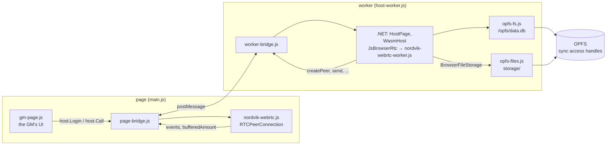

# NordvikManager.Wasm.Host

The browser-wasm GM host: the GM backend running in a browser tab instead of the native server. It starts `WasmHost` (`NordvikManager.Wasm.Hosting`), which builds the same layers as the native server (`InfrastructureLayerModule`, `ApplicationLayerModule`, `RealTimeLayerModule`) with the browser's own WebRTC (`NordvikManager.Wasm.WebRtc`), WebSocket-only signaling, and its games in a SQLite file on the browser's OPFS.

Not in the solution: browser-wasm needs the `wasm-tools` workload. The composition is in the solution and tested on the desktop (`WasmHostTests`).

## Page and worker

.NET runs in a dedicated worker, not on the page's thread:



- **Storage.** `opfs-fs.js` mounts an emscripten filesystem at `/opfs` over OPFS sync access handles, which only exist in dedicated workers. SQLite reads and writes `/opfs/data.db` in place: the database isn't held in memory, and every commit is flushed to OPFS (fsync → `handle.flush()`). Opening a handle is async, so the files (the database and its rollback journal) are opened before .NET starts; only they can exist there. Deleting a file empties it, and an empty file counts as missing (the rollback journal after each commit, a hot journal after a crash). A new database is made with a rollback journal before EF migrates it: EF would turn on WAL, which needs files this filesystem doesn't have (`WasmHost.MigrateSqlite`).
- **Files.** What the server keeps as files (uploads over 32 MB, files a card saves as files) is on OPFS too, under `storage/games/<game>/`: `BrowserFileStorage` (`NordvikManager.Wasm.Hosting`, the host's `IFileStorageProvider`) through `JsBrowserFiles` → `opfs-files.js`. Those files are made at any time, so they aren't opfs-fs.js's pre-opened ones: the C# side awaits the opening of a file, then reads and writes it with sync calls. A file's handle is opened once and kept (two ranges of one audio file at once share it). A save is written to `<file>.tmp`, flushed, then moved in place, so the database never points at a half-written file; a `.tmp` left by a closed tab is deleted at startup. What's there is listed once at startup, so `Exists` and the stamps (the resource cache's versions, OPFS's own last-modified times) don't change on a reload. A finished upload is copied in from the runtime's memory in 1 MB parts. Uploads still in progress are in memory: a reload cuts them off. A browser out of room answers the upload with 413 and says so.
- **One tab.** Holding the handles locks the files, so a second tab of the site says the games are open in another tab. A reload's new worker retries for 3 s while the old one lets go; the page also tells its worker to close the handles on `pagehide`.
- **Games from before OPFS** (a copy of `data.db` in IndexedDB, `nordvik-host`/`files`) are moved into an empty `data.db` once, and the IndexedDB copy is deleted after the host has opened them.
- **WebRTC.** A worker has no `RTCPeerConnection`, so the page owns them: `nordvik-webrtc-worker.js` has `nordvik-webrtc.js`'s exports (`JsBrowserRtc`'s `[JSImport]`s, unchanged) and forwards each call; events come back to `JsBrowserRtc`'s `[JSExport]`s. `bufferedAmount` (the send pump polls it) is mirrored: the amount the page last reported, after every send and on `bufferedamountlow`, plus what was sent since.
- **The bridge.** `worker-bridge.js` / `page-bridge.js`: calls (with an answer), notifications, callbacks into .NET, and the page calling `HostPage`'s `[JSExport]`s. Order is kept both ways.
- The page asks for persistent storage (`navigator.storage.persist()`), so the browser doesn't clear the games when the disk is nearly full.

`HostSelfCheck` and `storage-e2e.cjs` use their own files (`selfcheck.db` and `selfcheck-storage/`, `crash.db` and `crash-storage/`), never the GM's `data.db` and `storage/`.

## Starting the host from a page: host.js

`host.js` is what a page starts the host with: `startHost({ central })` makes the worker, serves it the page's WebRTC, and gives `{ worker, ready }`; `ready` resolves to `{ host, persisted }` (`host`: `HostPage`'s exports, `Login`, `Logout`, `UserName`, `Call`, each returning a promise) or rejects with an Error named `locked` when another tab has the games. This bundle's own page (`main.js`) uses it, and so does the frontend's **host build** (`REACT_APP_MODE=host`, served at Central's `/client/host/`): the full GM app, with this bundle copied into its `wasm/` folder, its backend calls answered by `host.Call`. Central's CSP for `/client/host/` allows `'wasm-unsafe-eval'` (compiling the runtime); without it the host stops at start.

`host-ui-e2e.cjs` drives the host build against a real Central with a real player client: log in, no server-only settings in the lobby, the host drawer, create a game, enter it (the GM app's data channel to the host in its own tab), chat, a player joins and both chat, leaving the tab while the game runs asks first, and after the reload the GM is back in the same game on the same Central session with the chat kept:

```bash
# the host build: NORDVIK_WASM_BUNDLE=<this AppBundle> REACT_APP_CENTRAL_URL=<central> pnpm buildci_host (frontend repo)
# Central: CORS_ORIGIN=http://localhost:<hostPort>,http://localhost:<playerPort>; gmtest / gm-test-pass-1 seeded
node NordvikManager.Wasm.Host/host-ui-e2e.cjs <host build> <player build> <playwright> <centralUrl> <hostPort> <playerPort>
```

## The GM's page

`index.html` is the GM's page: log in to Central, see your games, create one (built-in addons ticked), start or stop its session. The GM's Central tokens are held by the host (a browser can't keep Central's cookies), and the GM's actions run the same shared endpoints as everyone, with those tokens. The logged-in GM is the host's local admin. Central is the page's own origin (serve the host from Central's domain and no CORS is needed), or `?central=https://...`; otherwise Central's `CORS_ORIGIN` must list the page's origin. Keep the tab open while playing. After a reload the GM logs in again and starts the game on its same Central session.

`gm-e2e.cjs` drives it against a real Central in headless Chrome: a second tab is refused, log in, Basics offered, create a game, upload 33 MB to it as the GM (kept as a file on OPFS), start, stop, reload (the games open again, the game is there, the big file reads back right), and games kept in IndexedDB by an older host are moved to OPFS:

```bash
# a Central of your own: CORS_ORIGIN=http://localhost:<port>, an account (npm run seed with ADMIN_USERNAME/ADMIN_PASSWORD)
node NordvikManager.Wasm.Host/gm-e2e.cjs <AppBundle> [path/to/playwright] <port> <centralUrl> <user> <password>
```

`player-e2e.cjs` is the whole thing with a real player client: the GM hosts a game from the GM page, then the player client (a `REACT_APP_MODE=player` build of the frontend, with `REACT_APP_CENTRAL_URL` set to the test Central) opens the invite link `?game=<Central session>`, logs in, joins, sends a chat message, reloads and sees it again; then the GM reloads the host page, logs in, finds the game still there, starts it on the same Central session, and the player rejoins to the same chat history. It makes the player's account itself (an invite from the GM, then register) and prints what the host didn't answer 2xx.

```bash
# Central: CORS_ORIGIN=http://localhost:<hostPort>,http://localhost:<playerPort>; gmtest / gm-test-pass-1 seeded
node NordvikManager.Wasm.Host/player-e2e.cjs <host AppBundle> <player build> <playwright> <centralUrl> <hostPort> <playerPort>
```

`storage-e2e.cjs` cuts the host off mid-commit, twice (the worker terminated outright, then the whole browser closed, on a persistent profile), and checks the database each time (`PRAGMA integrity_check`, every row whole: `SelfCheck/StorageCrashCheck.cs`), and the file the writer kept saving between commits (one whole version, never a half-written one):

```bash
node NordvikManager.Wasm.Host/storage-e2e.cjs <AppBundle> <playwright> <profile folder, deleted after>
```

## The self-check

`index.html?selfcheck`. It runs the host in its worker as it would host a game, with Central left out: the real `WebRTCSessionService` and `GameLobby` serve a player in the page (`SelfCheck/selfcheck-player.js`, speaking the player client's data channel protocol, reached through `selfcheck-player-worker.js`) connected through in-page signaling. Each step prints a `CHECK` line:

- the host builds (every registration validated); it runs in a worker;
- games kept in OPFS: a fresh database migrates on `/opfs/selfcheck.db`, its commits are flushed, and a new host on the same file lists the game;
- files kept in OPFS: saved, saved again, an upload moved in, two overlapping ranges at once, the same stamps from a new `BrowserFileStorage`, deleted; the GM uploads 3 MB asking for file storage (`UploadStart`/`UploadPart`/`UploadFinish`), it's on OPFS and a `ResourceRange` reads back right;
- MediatR + EF Core create and list a game; `api/Host/Info` says browser; Basics is installed in a new game;
- the lobby opens; the player connects over the browser's WebRTC (through the page);
- the heartbeat is answered;
- tunnelled REST through `ApiRouter` and the shared endpoints: `GetPlayer`, `GetFullGame`, `session/whoami` (the channel's game), `user/userinfo` (the caller); a server-only route (`api/meta`) answers 501 saying so;
- a file uploaded in parts (`materials/UploadStart`, `UploadPart`, `UploadFinish`: upload store, fixed quota, database) and read back through `materials/resource`; addon step definitions;
- a chat message goes through `GameLobby` (player resolution, `ChatHandler`, MediatR) and comes back;
- a 31 504-char chat (emoji included) goes both ways chunked: chunk reassembly and the send pump (with the mirrored `bufferedAmount`).

## Not yet

- Server-only routes answer 501 by design (backup, server settings, updates, Central's meta, linking files on a disk); everything else a player client calls is answered. `GET api/Host/Info` lists them, with the host's limitations.
- Upload parts are in the runtime's memory while an upload runs: a reload cuts it off and it starts over (finished ones are on OPFS).
- Deleting a game leaves its files (as on a GM server): they stay in `storage/games/<game>/`.

## Run the self-check

Needs the `wasm-tools` workload, Node, Playwright and Chrome.

```bash
dotnet build NordvikManager.Wasm.Host -c Release --artifacts-path <out>
node NordvikManager.Wasm.Host/selfcheck.cjs <out>/bin/NordvikManager.Wasm.Host/release_browser-wasm/AppBundle [path/to/playwright]
# CHROME_PATH=... for another Chrome/Chromium; exit code 0 = PASS
```
